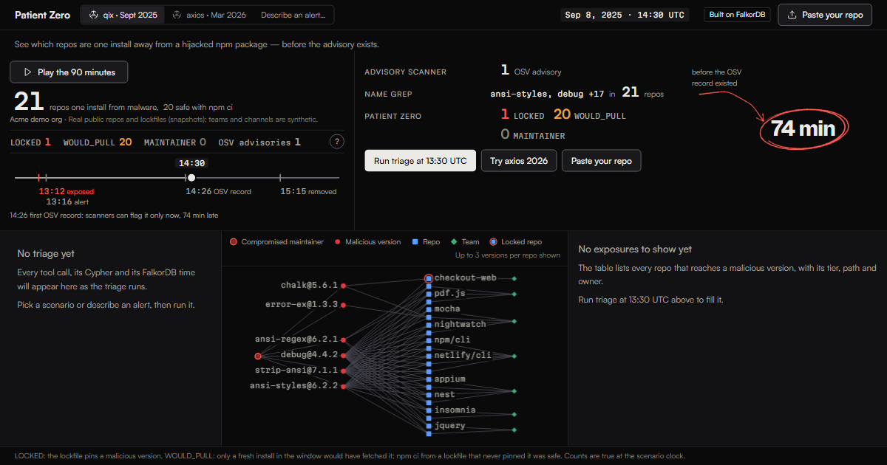

# Patient Zero

**Exposed before the advisory exists.** When an npm maintainer account is hijacked, Patient Zero shows which of your repos are one fresh install away from the malware, through which exact lockfile path, and who owns the fix, before advisory-based scanners have a record to match.



**[Live demo](https://patient-zero-rayp.onrender.com)** · **Video (2:30): coming 18 Oct** · [Run locally](#run-it-locally) · [Data model](#graph-data-model) · [Cypher](#every-cypher-query) · [MCP](#mcp-transcript) · [AI use](#ai-use-disclosure) · [Blog](https://dev.to/yasharyas/74-minutes-before-the-advisory-graph-triage-for-npm-account-hijacks-20j9)

Built for **FalkorDB Graph Hacks** (WeMakeDevs), **Track 1: Agents That Act on Connected Data**. The live demo needs no sign-up: it opens on a seeded demo org, or you paste your own repo. MIT licensed. Runs on free tiers only.

## Judges: verify it in 60 seconds

1. **Land and watch.** The timeline autoplays the qix incident from 13:05 to 14:30 UTC in about 12 s. From about 2 s the hero reads "21 repos one install from malware" (1 `LOCKED`, 20 `WOULD_PULL`) next to "Advisory scanner 0", and the caption reads "no advisory for 74 min, until 14:26". Only the circle around the "74 min" figure waits until the playhead passes 14:26.
2. **Run triage.** Click **Run triage at 13:30 UTC**. 49 read-only graph calls stream in as tool cards, each with its rows, its Cypher and FalkorDB's time in ms. The verdict, the notify list and the fix steps are built from those rows.
3. **Click `mochajs/mocha`** in the exposure table. The path graph draws its chain: mocha declares `debug ^4.3.5` in its own `package.json`, a range that admitted the malicious `debug@4.4.2` (zero hops from the lockfile root). **Fix** drafts the pin and the PR body; **Notice** drafts the Slack message for the owning team.
4. **Open a tool card, copy a Cypher statement and run it.** Each statement's **Copy** puts that run's parameters in front of it, so it runs as pasted. With `docker compose up`, copy the first card's statement (`suspect_versions`) and run `docker compose exec falkordb redis-cli GRAPH.RO_QUERY pz_acme_qix '<paste>'`. Any statement also pastes as is into the FalkorDB Browser on http://localhost:3000. **Show plan** on a card fetches its `GRAPH.EXPLAIN` plan.
5. **Paste a public repo.** Click **Paste your repo** and type `owner/name`. The repo gets its own graph via `GRAPH.COPY`, its lockfile as committed just before the incident (today's, labelled as such, if there is no earlier one), and the same playbook (9 calls for one exposed repo).

Then ask a follow-up in the **Ask** box. "Which exposures are prod-only and who owns them?" is answered from the graph: 14 repos across 6 teams.

## What the agent does

**Perceive**
- **Alert to target.** A free-text alert ("qix compromised, 13:16 UTC") sets the incident and the clock, and `find_target` resolves its terms to `Maintainer`, `Package`, `Version` or `Incident` nodes with exact, indexed lookups. No model parses it.
- **Graph playbook, read-only.** Every tool runs `GRAPH.RO_QUERY` on FalkorDB as the ACL user `pz_ro`. What runs next depends on what came back: `suspect_versions` runs only while no bad version is known, and `explain_path` and `draft_remediation` run once per exposed repo. That makes 49 calls for the demo org at qix 13:30, and 9 for one pasted repo.

**Decide**
- **Tiers from Cypher, one pick from the LLM.** `LOCKED`, `WOULD_PULL`, `MAINTAINER` and `CLEAN` come from the queries. The server builds up to four observations at a time from the results (the malicious version that reaches the most repos, a carrier dependency many repos' shortest paths share, the ranges repos declare themselves, the busiest team, a repo that would fetch several malicious versions), and one LLM call answers with the id of the one most worth acting on. It chooses; it never writes a sentence.

**Act**
- **Drafts.** For each exposed repo: version-qualified `overrides`, the steps and a PR body. For each owning team: one Slack notice (7 teams at qix 13:30). Nothing is sent.
- **Writes back.** Each run writes `(:Triage)-[:FOR]->(:Incident)` and `(:Triage)-[:ASSESSED {tier, action}]->(:Repo)` as the write user `pz_rw`. **Mark remediated** writes `action: 'remediated'`. `recall_triage` reads both on the next run, so a fixed repo shows as remediated and the **Triage history** tab lists it. All of it is scoped to an anonymous session.
- **Same tools over MCP.** The ten read-only tools are also a stdio MCP server for Claude Code or Claude Desktop ([transcript below](#mcp-transcript)).

## The 74-minute window

On 2025-09-08 the npm account `qix` was hijacked. `ansi-styles@6.2.2` went out at 13:12:10 UTC, `debug@4.4.2` at 13:12:39. Someone raised the alarm in about four minutes (Aikido, ~13:16). The first OSV record, MAL-2025-46974 for `debug`, was published at 14:26:51. For **74 minutes**, `npm audit`, OSV and Dependabot had no record to match a lockfile against.

On 2026-03-31 it was `axios`. `axios@1.14.1` was published at 00:21:58 UTC and had no OSV record for **2 h 54 min**.

Detection was not the gap; vendors flagged both quickly. The gap is the next question on the on-call engineer's screen: *which of our repos does this reach, through what, and who do I page?* Patient Zero is a **triage layer, not a detector**. Give it the alarm ("qix is compromised") and it answers that question from a FalkorDB graph of maintainers, versions, declared ranges, lockfile entries, repos and teams, with the Cypher behind every answer.

> **What the tiers mean, before you quote the numbers.**
> `WOULD_PULL`: a *fresh resolve* during the window would have fetched the malicious version. That is a new clone plus `npm install`, a lockfile regeneration, `npx`, a Dependabot run, CI without `npm ci`, or the project's own downstream consumers. It is **not** a claim that the project was compromised. `npm ci` from a committed lockfile was safe throughout both incidents.
> `LOCKED`: the lockfile itself pins a malicious version. It appears only on two clearly badged synthetic repos, `acme/checkout-web` and `acme/billing-api`.
> The 20 other repos are real public projects, read from lockfiles committed just before each incident. Teams and Slack channels are synthetic.

## Architecture

```text
alert ("qix is compromised") or a scenario clock
  |
  v
Node server: triage playbook, deterministic, 49 read-only tool calls
  |   find_target > suspect_versions > incident_exposure > explain_path
  |   > route_owners > draft_remediation > concentration_risk > scanner_view
  |
  +-- GRAPH.RO_QUERY as ACL user pz_ro ----------> FalkorDB
  |                                                pz_registry            template: incidents, advisories, version timelines
  |                                                pz_acme_qix            GRAPH.COPY + lockfiles as of 2025-09-08T13:00Z
  |                                                pz_acme_axios          GRAPH.COPY + lockfiles as of 2026-03-31T00:00Z
  |                                                pz_guest_<sha>_<scn>   GRAPH.COPY + one pasted repo (LRU 4, TTL 1 h)
  |
  +-- one LLM call (Groq / Gemini free tier): picks ONE observation id from graph-built facts
  |
  +-- ACL user pz_rw (never a tool): GRAPH.COPY + guest ingest, session-scoped Triage records, remediation marks
  |
  +-- SSE --> web UI: timeline, tool cards with Cypher + GRAPH.EXPLAIN, Fix / Notice, Ask box, paste a repo
  +-- stdio > MCP server: the same read-only tools inside Claude Code / Claude Desktop
```

## What it found (verified numbers, see `docs/proof-points.md`)

- **qix at 13:30 UTC:** 20 of 20 real public repos would fetch at least one malicious version on a fresh resolve (13 through production dependencies), plus the synthetic `acme/checkout-web` (LOCKED). `npm/cli`, `mochajs/mocha`, `remy/nodemon` and `github/docs` declare a hijacked package directly in their own `package.json`.
- **axios at 01:30 UTC:** 9 of 20 repos; `louislam/uptime-kuma` declares `axios ~0.30.3`, which resolved to the malicious 0.30.4. The app shows **106 min** ahead of the campaign's first OSV record (MAL-2026-2306).
- **Scanner view:** 0 hits at both clocks, until the first advisory lands.
- **Graph size:** `pz_acme_qix` holds 46,810 nodes and 123,426 edges (24 MB), built in about 3.3 s; the baked RDB is 11.6 MB.
- Repos are real public projects, analysed as of their lockfiles just before each incident (`data/cache/lockfiles/manifest.json` pins every SHA).

## Why the graph does the work

Every answer is a traversal; there is no in-app dependency model. Stop FalkorDB and nothing renders. The graph-free `scripts/exposure-oracle.ts` is only a differential test: it reproduces the tier counts from the raw lockfiles, with no paths from the root, owners, carrier grouping, concentration or tenancy, and the app never calls it.

| Question | How the graph answers |
|---|---|
| Which versions did the hijacked account just publish? | `Maintainer -MAINTAINS-> Package <-OF- Version` filtered by publish time (`SUSPECT_VERSIONS`), before any advisory |
| Who would fetch them on a fresh install, and when? | time-windowed `ADMITS {range, fromT, toT}` edges from the declaring lockfile entry to the bad version (`EXPOSURE_ADMITS`) |
| Through which exact path? | `shortestPath` over per-repo `REQUIRES` from the repo root (`EXPLAIN_PATH`) |
| Who owns the fix? | `Repo -OWNED_BY-> Team` (`ROUTE_OWNERS`) |
| Who could be the next qix? | `algo.pageRank` over the package dependency projection, summed per maintainer (`CONCENTRATION_RISK`) |
| What would a scanner see? | one hop, lockfile vs. published OSV records (`SCANNER_VIEW`): **0** until the first OSV record lands, and never a `WOULD_PULL` repo, since those lockfiles pin safe versions |

One graph per (tenant, scenario) via `GRAPH.COPY` of a registry template; pasted repos get their own `pz_guest_*` graph.

## What this proves about FalkorDB

- **Multigraph tenancy.** `pz_registry` holds the incidents, advisories and every version timeline once. `GRAPH.COPY` stamps out one graph per tenant and scenario (`pz_acme_qix`, `pz_acme_axios`) and one per pasted repo (`pz_guest_<sha256[0:12]>_<scenario>`, LRU 4, TTL 1 h), so a guest's lockfile never shares a graph with the demo org and the name is never user-controlled.
- **Time-windowed edges.** `ADMITS {range, fromT, toT}` records when a declared range started and stopped resolving to a bad version. "Who was exposed at 13:30?" is a property filter on the edge, not a replay of the registry.
- **`shortestPath` with `Dep.depth`.** `EXPLAIN_PATH` reads the repo's lockfile entries through the `Dep.repo` index (its `GRAPH.EXPLAIN` plan starts with `Node By Index Scan | (x:Dep)`), keeps those whose `RESOLVES_TO` or live `ADMITS` edge reaches the bad `Version`, orders them by `Dep.depth` (BFS depth from the root, computed at ingest) and runs `shortestPath((root)-[:REQUIRES*0..]->(x))` only for the three shallowest. The root comes from the `Repo.id` index. `*0..` covers a range declared by the root itself.
- **PageRank.** `CALL algo.pageRank` over the `PKG_DEPENDS` projection writes `Package.pagerank`; `CONCENTRATION_RISK` sums it per maintainer to answer "who could be the next qix?" Top mass in the demo graph: sindresorhus, ljharb, types.
- **`GRAPH.EXPLAIN` on every card.** "Show plan" fetches the execution plan for a tool's main query and the UI matches it to the statement it describes.
- **Read-only ACL user.** Every tool runs `GRAPH.RO_QUERY` as `pz_ro` (`+GRAPH.RO_QUERY +GRAPH.EXPLAIN +GRAPH.LIST +PING +HELLO +CLIENT +INFO`); `GRAPH.QUERY` and `GRAPH.DELETE` get NOPERM. A separate `pz_rw` user writes the session-scoped triage records.

## Graph data model

```
(Repo)-[:IN_ORG]->(Org)            (Repo)-[:OWNED_BY]->(Team)       (Repo)-[:ROOT]->(Dep)
(Dep)-[:REQUIRES {range, kind}]->(Dep)                              one Dep per lockfile location
(Dep)-[:RESOLVES_TO]->(Version)    (Version)-[:OF]->(Package)
(Maintainer)-[:MAINTAINS]->(Package)                                (Version)-[:PUBLISHED_BY]->(Maintainer)
(Dep)-[:ADMITS {range, fromT, toT}]->(Version)                      range resolved to the bad version while it was live
(Incident)-[:INVOLVES]->(Version)  (Incident)-[:COMPROMISED]->(Maintainer)   (Advisory)-[:FLAGS]->(Version)
(Version)-[:PULLS_IN]->(Version)   (Package)-[:PKG_DEPENDS]->(Package)      projection for PageRank
(Triage)-[:FOR]->(Incident)        (Triage)-[:ASSESSED {tier, action}]->(Repo)
```

Why one `Dep` node per lockfile location instead of shared `Version -> Version` edges: shared edges would invent paths that exist in no real lockfile. Full schema: `docs/contracts.md`.

## How the agent decides

- **Triage** (default): a deterministic, graph-driven playbook (suspect versions -> exposure -> blast radius -> paths -> owners -> remediation -> concentration -> scanner view). The verdict, notify list and fix steps are built straight from those results, so they are complete with no LLM at all. **One** LLM call then picks the observation most worth acting on from up to four at a time that the server builds from the graph (the widest-reaching malicious version, a shared carrier dependency, directly declared ranges, the busiest team, a repo with several malicious versions). What the verdict already says (tier counts, the prod split, the advisory gap) is never offered again. It answers with an id, so it chooses but never writes. A guard checks every claim (repos, `name@version`, counts, `[E#]` citations) against the tool results. Free tiers: Groq `qwen/qwen3.8-27b` -> Groq `gpt-oss-120b` -> Gemini `3.5-flash-lite` -> recorded pick -> none. A replayed pick is a recorded observation id, not prose: its words are rebuilt from the fresh run's rows, and it is used only if that run still offers the observation.
- **Ask**: questions the graph can answer itself get a server-built answer and server-chosen tool calls. These are lists and filters ("which exposures are prod-only?"), a named repo ("what should acme/checkout-web do?"), a named account ("if ljharb were hijacked next, which repos would it reach?"), the maintainers with the widest reach, teams, malicious versions and carriers ("which dependency should we change first?", "which repos get debug@4.4.2 through @babel/core?"), "which repos need secrets rotated, is npm ci safe?", who to notify, and when it started. A question whose named repo, team, package or account the graph route would not use is refused with the reason, never answered with something else. Anything else goes to a bounded tool loop (4 LLM calls, 6 tool calls) where the model picks graph tools itself, and the guard checks every name in its answer.
- **MCP**: the same read-only tools over stdio for Claude Code / Claude Desktop (`docs/mcp.md`).

## MCP transcript

`server/mcp.ts` serves ten read-only tools over stdio; `recall_triage` stays session-scoped and is not exposed. Setup for Claude Code and Claude Desktop is in `docs/mcp.md`. The transcript below was captured on 2026-10-16 with a plain JSON-RPC client against the dev graphs (`FALKOR_PORT=6380 REDIS_PASSWORD=devpass node server/mcp.ts`). The first result row is verbatim; the rest is cut where marked `…`.

```text
-> initialize
<- serverInfo {"name":"patient-zero","version":"1.0.0"}, protocol 2025-06-18
-> tools/list
<- find_target, suspect_versions, incident_exposure, maintainer_blast_radius, explain_path,
   route_owners, concentration_risk, draft_remediation, scanner_view, filter_exposures
   (each with readOnlyHint: true and a required scenario)
-> tools/call explain_path {"scenario":"qix-2025-09-08","repo":"socketio/socket.io","version":"debug@4.4.2","at":"2025-09-08T13:30:00Z"}
<- {"summary":"socketio/socket.io: its dependency @babel/core@7.24.7 declares ^4.1.0, admitting debug@4.4.2 (1 hop deep)",
    "params":{"repo":"socketio/socket.io","version":"debug@4.4.2","at":1757338200000},"rowCount":3,"rows":[
    {"chain":["socketio/socket.io","@babel/core@7.24.7"],"range":"^4.1.0","hops":1,"kind":"ADMITS","repo":"socketio/socket.io","version":"debug@4.4.2","depth":1,"lockPaths":["","node_modules/@babel/core"]},
    {"chain":["socketio/socket.io","@fails-components/webtransport@1.1.4"],"range":"^4.3.4","hops":1,"kind":"ADMITS",…},
    …]}
<- Cypher (GRAPH.RO_QUERY on pz_acme_qix):
   MATCH (:Repo {id: $repo})-[:ROOT]->(root:Dep)
   MATCH (:Version {id: $version})<-[e:RESOLVES_TO|ADMITS]-(x:Dep {repo: $repo})
   …
```

The `@babel/core` hop is the carrier that the recorded analyst pick names in the app: it is on the shortest path of 4 repos, and on some path of 16 (ask "which repos get debug@4.4.2 through @babel/core?").

## Run it locally

```bash
docker compose up --build
```

App on http://localhost:8080, FalkorDB Browser on http://localhost:3000 (run the queries below yourself). Development: `docker run -d -p 127.0.0.1:6380:6379 -e REDIS_ARGS="--requirepass devpass" falkordb/falkordb`, then `npm ci`, `npm run fonts`, `npm run build:graph`, `npm run dev` and `npm run dev:web`. Tests: `npm test`.

## Every Cypher query

Generated from `server/tools/cypher.ts` by `node scripts/gen-readme-cypher.ts`; `test/readme.test.ts` fails if this drifts from the code.

**Run one yourself.** Every query takes `$parameters` (times are epoch milliseconds). In the FalkorDB Browser (http://localhost:3000 with `docker compose up`; log in with host `localhost`, port `6379` and the `REDIS_PASSWORD` from your `.env`, default `pz-dev-redis`), pick the graph `pz_acme_qix` and paste a query with its parameters in front. This one returns the 19 versions the hijacked `qix` account published between 13:00 and 14:30 UTC on 2025-09-08, 74 minutes before the first OSV record:

```cypher
CYPHER maintainer="qix" since=1757336400000 until=1757341800000
MATCH (:Maintainer {name: $maintainer})-[:MAINTAINS]->(p:Package)<-[:OF]-(v:Version)
WHERE v.publishedAt >= $since AND v.publishedAt < $until
RETURN v.id AS version, p.name AS package, v.publishedAt AS publishedAt, v.removed AS removed
ORDER BY publishedAt LIMIT 40
```

From a shell (with `docker compose up` running):

```bash
docker compose exec falkordb redis-cli GRAPH.RO_QUERY pz_acme_qix 'CYPHER maintainer="qix" since=1757336400000 until=1757341800000 MATCH (:Maintainer {name: $maintainer})-[:MAINTAINS]->(p:Package)<-[:OF]-(v:Version) WHERE v.publishedAt >= $since AND v.publishedAt < $until RETURN v.id AS version, v.publishedAt AS publishedAt ORDER BY publishedAt LIMIT 40'
```

In the app, every tool card's **Copy Cypher** puts the parameters of that run in front of each statement, so what you copy runs as is (13:30 UTC on 2025-09-08 is `at=1757338200000`).

<details>
<summary><b>Every query, generated verbatim from <code>server/tools/cypher.ts</code></b></summary>

<!-- cypher:start -->

#### `FIND_TARGET`

find_target: exact, indexed lookups for the terms of a free-text alert (package, maintainer, name@version, incident id).

```cypher
UNWIND $terms AS t MATCH (n:Maintainer {name: t}) RETURN 'Maintainer' AS label, n.name AS id
UNION UNWIND $terms AS t MATCH (n:Version {id: t}) RETURN 'Version' AS label, n.id AS id
UNION UNWIND $terms AS t MATCH (n:Package {name: t}) RETURN 'Package' AS label, n.name AS id
UNION UNWIND $terms AS t MATCH (n:Incident {id: t}) RETURN 'Incident' AS label, n.id AS id
```

#### `SUSPECT_VERSIONS`

suspect_versions: pre-advisory detection. Every version of the account's packages published in the window.

```cypher
MATCH (:Maintainer {name: $maintainer})-[:MAINTAINS]->(p:Package)<-[:OF]-(v:Version)
WHERE v.publishedAt >= $since AND v.publishedAt < $until
RETURN v.id AS version, p.name AS package, v.publishedAt AS publishedAt, v.removed AS removed
ORDER BY publishedAt LIMIT 40
```

#### `INCIDENT`

Incident header for a run (not a tool): times, versions, the compromised account, the lockfile snapshot time and the org ('guest' for a pasted repo's graph).

```cypher
MATCH (i:Incident {id: $incident})-[:INVOLVES]->(v:Version)
OPTIONAL MATCH (i)-[:COMPROMISED]->(m:Maintainer)
OPTIONAL MATCH (o:Org)
RETURN i.id AS id, i.title AS title, m.name AS maintainer, i.firstPublishAt AS firstPublishAt, i.alertAt AS alertAt,
  i.advisoryAt AS advisoryAt, i.removedAt AS removedAt, i.sources AS sources, o.snapshotAt AS snapshotAt, o.id AS org,
  collect({id: v.id, publishedAt: v.publishedAt}) AS versions
```

#### `FIRST_EXPOSURE`

Incident header (not a tool): the first moment this graph shows any repo exposed, under incident_exposure's rule (a repo that locks a bad version starts at its LOCKED since, any other at its earliest ADMITS window). It anchors "minutes ahead of the advisory" everywhere.

```cypher
MATCH (:Incident {id: $incident})-[:INVOLVES]->(bad:Version)<-[:RESOLVES_TO]-(d:Dep)
RETURN d.repo AS repo, max(bad.publishedAt) AS since, true AS locked
UNION ALL
MATCH (:Incident {id: $incident})-[:INVOLVES]->(bad:Version)<-[a:ADMITS]-(p:Dep)-[r:REQUIRES]->(l:Dep)
WHERE a.fromT < a.toT AND l.name = bad.name AND r.range = a.range
RETURN p.repo AS repo, min(a.fromT) AS since, false AS locked
```

#### `REPOS`

incident_exposure (1/3): every repo and its owning team, so CLEAN is counted too.

```cypher
MATCH (r:Repo) OPTIONAL MATCH (r)-[:OWNED_BY]->(t:Team)
RETURN r.id AS repo, r.synthetic AS synthetic, t.name AS team ORDER BY repo
```

#### `EXPOSURE_LOCKED`

incident_exposure (2/3) LOCKED: lockfile entries that resolve to a malicious version. A lockfile can't predate the newest bad version it locks, so that publish time is the repo's `since`: before it, none of the repo's hits count.

```cypher
MATCH (:Incident {id: $incident})-[:INVOLVES]->(bad:Version)<-[:RESOLVES_TO]-(d:Dep)
WITH d.repo AS repo, bad, min(d.depth) AS depth, collect(DISTINCT d.dev) AS devFlags
WITH repo, max(bad.publishedAt) AS since, collect({version: bad.id, depth: depth, devFlags: devFlags}) AS hits
UNWIND hits AS h
RETURN repo, h.version AS version, h.depth AS depth, h.devFlags AS devFlags, since
```

#### `EXPOSURE_ADMITS`

incident_exposure (3/3) WOULD_PULL: a declared range resolved to a malicious version while it was live at $at. The REQUIRES hop to the locked entry gives the dev/prod badge and what the lockfile pins for that range instead.

```cypher
MATCH (:Incident {id: $incident})-[:INVOLVES]->(bad:Version)<-[a:ADMITS]-(p:Dep)-[r:REQUIRES]->(l:Dep)
WHERE a.fromT <= $at AND $at < a.toT AND l.name = bad.name AND r.range = a.range
RETURN p.repo AS repo, bad.id AS version, min(p.depth) AS depth, collect(DISTINCT l.dev) AS devFlags,
  collect(DISTINCT a.range)[0..3] AS ranges, min(a.fromT) AS since, collect(DISTINCT l.name + '@' + l.version) AS locked
```

#### `EXPOSURE_CARRIERS`

filter_exposures (carriers, via): per repo and malicious version, every dependency whose declared range admits it at $at ('' = the repo's own package.json). Changing one of them touches only the repos it carries; an override on the malicious version covers every carrier.

```cypher
MATCH (:Incident {id: $incident})-[:INVOLVES]->(bad:Version)<-[a:ADMITS]-(p:Dep)-[r:REQUIRES]->(l:Dep)
WHERE a.fromT <= $at AND $at < a.toT AND l.name = bad.name AND r.range = a.range
RETURN p.repo AS repo, bad.id AS version, collect(DISTINCT CASE WHEN p.path = '' THEN '' ELSE p.name END) AS carriers
```

#### `MAINTAINER_BLAST_RADIUS`

maintainer_blast_radius: MAINTAINER tier. Repos whose lockfile contains any package the account maintains.

```cypher
MATCH (:Maintainer {name: $maintainer})-[:MAINTAINS]->(pkg:Package)<-[:OF]-(:Version)<-[:RESOLVES_TO]-(d:Dep)
RETURN d.repo AS repo, count(DISTINCT pkg) AS packages, collect(DISTINCT pkg.name)[0..6] AS sample,
  min(d.depth) AS shallowest, collect(DISTINCT d.dev) AS devFlags
ORDER BY packages DESC, repo
```

#### `EXPLAIN_PATH`

explain_path: the exact lockfile chain from the repo root to the entry that locks (RESOLVES_TO) or declares a range admitting (ADMITS, live at $at) the version. *0.. covers a range declared by the root itself (0 hops). Dep.depth is the BFS depth from the root, so only the 3 shallowest entries need a shortestPath walk.

```cypher
MATCH (:Repo {id: $repo})-[:ROOT]->(root:Dep)
MATCH (:Version {id: $version})<-[e:RESOLVES_TO|ADMITS]-(x:Dep {repo: $repo})
WHERE type(e) = 'RESOLVES_TO' OR (e.fromT <= $at AND $at < e.toT)
WITH root, x, e ORDER BY type(e) DESC, x.depth LIMIT 3
WITH root, x, e, shortestPath((root)-[:REQUIRES*0..]->(x)) AS p
RETURN type(e) AS kind, e.range AS range, length(p) AS hops, x.depth AS depth,
  [n IN nodes(p) | n.name + '@' + n.version] AS chain, [n IN nodes(p) | n.path] AS lockPaths
ORDER BY kind DESC, hops LIMIT 3
```

#### `NODE_COUNTS`

graph stats (the Graph stats tab, before any triage): how many nodes each demo graph holds, per label (visitors' session Triage records left out).

```cypher
MATCH (n) WHERE NOT n:Triage RETURN labels(n)[0] AS label, count(n) AS count ORDER BY count DESC
```

#### `EDGE_COUNTS`

graph stats: how many relationships, per type (REQUIRES is the lockfile tree, ADMITS the time-windowed exposure).

```cypher
MATCH ()-[r]->() WHERE NOT type(r) IN ['FOR', 'ASSESSED'] RETURN type(r) AS type, count(r) AS count ORDER BY count DESC
```

#### `ROUTE_OWNERS`

route_owners: who to notify.

```cypher
MATCH (r:Repo)-[:OWNED_BY]->(t:Team) WHERE r.id IN $repos
RETURN t.name AS team, t.channel AS channel, collect(r.id) AS repos ORDER BY team
```

#### `CONCENTRATION_RISK`

concentration_risk: "who is the next qix?" PageRank over the package dependency projection, summed per maintainer.

```cypher
MATCH (m:Maintainer)-[:MAINTAINS]->(p:Package)
WITH m, sum(p.pagerank) AS influence, count(p) AS packages ORDER BY influence DESC LIMIT $top
MATCH (m)-[:MAINTAINS]->(:Package)<-[:OF]-(:Version)<-[:RESOLVES_TO]-(d:Dep)
RETURN m.name AS maintainer, influence, packages, count(DISTINCT d.repo) AS reposReached ORDER BY influence DESC
```

#### `REMEDIATION_VERSIONS`

draft_remediation (1/2): installable, non-malicious versions of each bad version's package that were live at $at.

```cypher
MATCH (bad:Version)-[:OF]->(:Package)<-[:OF]-(v:Version)
WHERE bad.id IN $versions AND v.publishedAt <= $at AND coalesce(v.removed, false) = false
RETURN bad.id AS bad, bad.name AS package, v.version AS version, v.publishedAt AS publishedAt, coalesce(v.malicious, false) AS malicious
```

#### `REMEDIATION_RANGES`

draft_remediation (2/2): the repo's ranges that lock or admit each bad version (the pin must satisfy all of them), whether the repo root declares it and as what (npm rejects an override that conflicts with a direct dependency), what the lockfile pins for that range, and when the range stopped admitting the bad version.

```cypher
MATCH (bad:Version)<-[:RESOLVES_TO]-(d:Dep)<-[r:REQUIRES]-(p:Dep)
WHERE bad.id IN $versions AND d.repo = $repo
RETURN bad.id AS bad, r.range AS range, 'RESOLVES_TO' AS kind, p.path = '' AS direct, r.kind AS dep, bad.id AS locked, null AS until
UNION
MATCH (bad:Version)<-[a:ADMITS]-(p:Dep)-[r:REQUIRES]->(l:Dep)
WHERE bad.id IN $versions AND p.repo = $repo AND l.name = bad.name AND r.range = a.range
RETURN bad.id AS bad, a.range AS range, 'ADMITS' AS kind, p.path = '' AS direct, r.kind AS dep, l.name + '@' + l.version AS locked, a.toT AS until
```

#### `SCANNER_VIEW`

scanner_view (1/2): the "graph off" baseline. What an advisory-based scanner reports at $at (lockfile vs. OSV, one hop).

```cypher
MATCH (a:Advisory)-[:FLAGS]->(v:Version)<-[:RESOLVES_TO]-(d:Dep)
WHERE a.publishedAt <= $at
RETURN DISTINCT d.repo AS repo, v.id AS version, a.id AS advisory ORDER BY repo, version, advisory
```

#### `NAME_GREP`

scanner_view (2/2): name grep. Repos where a bad package's name appears at all, with no version, path or owner.

```cypher
MATCH (:Incident {id: $incident})-[:INVOLVES]->(bad:Version)
MATCH (d:Dep) WHERE d.name = bad.name
RETURN count(DISTINCT d.repo) AS repos
```

#### `CHANGE_TIMES`

Timeline (server only): every moment an exposure tier or scanner count can change. Between two of them every incident_exposure / scanner_view answer is the same, so the 1-minute timeline runs those once per segment.

```cypher
MATCH (:Incident {id: $incident})-[:INVOLVES]->(v:Version) RETURN v.publishedAt AS t
UNION MATCH (:Incident {id: $incident})-[:INVOLVES]->(:Version)<-[a:ADMITS]-(:Dep) RETURN a.fromT AS t
UNION MATCH (:Incident {id: $incident})-[:INVOLVES]->(:Version)<-[a:ADMITS]-(:Dep) RETURN a.toT AS t
UNION MATCH (a:Advisory) RETURN a.publishedAt AS t
```

#### `RECALL_TRIAGE`

recall_triage: this session's earlier assessments and remediation marks for the incident (S10: scoped by session).

```cypher
MATCH (t:Triage {session: $session})-[:FOR]->(:Incident {id: $incident})
MATCH (t)-[a:ASSESSED]->(r:Repo)
RETURN r.id AS repo, a.tier AS tier, a.action AS action, t.at AS at ORDER BY at DESC
```

#### `RECORD_TRIAGE`

recordTriage (server only, GRAPH.QUERY): never exposed as a tool.

```cypher
MATCH (i:Incident {id: $incident})
CREATE (t:Triage {id: $id, at: $at, session: $session, summary: $summary, marked: $marked})-[:FOR]->(i)
WITH t UNWIND $assessed AS x
MATCH (r:Repo {id: x.repo})
CREATE (t)-[:ASSESSED {tier: x.tier, action: x.action}]->(r)
```

#### `PRUNE_TRIAGE`

recordTriage (server only): keep runtime triage memory bounded in the shared graphs, oldest first. Runs and remediation marks are capped apart, so other visitors' runs can never push a session's marks out.

```cypher
MATCH (t:Triage) WHERE coalesce(t.marked, false) = $marked
WITH t ORDER BY t.at DESC SKIP 1000 DETACH DELETE t
```

<!-- cypher:end -->

</details>

## Security

A public, unauthenticated demo, built to 13 written rules (`docs/decisions.md`): parameterized Cypher only (params are validated because the client inlines them), read-only ACL user for every tool and a separate write user, no SSRF (we build every outbound URL ourselves, allowlisted hosts, no redirects), lockfile size and shape caps, prompt-injection guard, strict CSP, per-client rate limits, session-scoped memory, no emails stored, non-root container with read-only code. Two AI-run security reviews (Opus, read-only, against S1 to S13) gated the build, after Phase 1 and after Phase 3, and were re-run in QA rounds 3 to 6. Their findings and fixes are in `docs/decisions.md`, `qa/reports/phase3-security.md` and `qa/security/`.

## Limits

Two incidents are ingested: qix (2025-09-08) and axios (2026-03-31). The scenario picker and the alert box know only those two. Paste-your-repo is general: any public GitHub repo with a `package-lock.json`, or a pasted lockfile, gets its own graph and is checked against either incident. npm `package-lock.json` v2/v3 only (no yarn/pnpm yet). Only the repo's root `package-lock.json` is read: lockfiles in subfolders (monorepo packages, fixtures) are not, so a nested lockfile's exposure is missed. `overrides`/`resolutions` are not modelled. `latest` is treated as "highest stable" rather than a moving dist-tag. Removal times are approximate (the registry keeps no removal timestamp).

## Roadmap (not in v1)

- **GitHub App** for private repos. v1 reads public repos and pasted lockfiles only.
- **Registry watcher** that follows publish events for the maintainers your graph depends on, so triage starts from the publish rather than from someone's alarm.
- **Slack actions**: send the Notice from the app and record the acknowledgement on the graph. v1 drafts the message for you to copy.
- **yarn.lock, pnpm-lock.yaml and PyPI** lockfiles. v1 is npm `package-lock.json` v2/v3.

## AI-use disclosure

Built with Claude Code (Anthropic) as the coding assistant, under the author's direction; the author reviewed every Cypher query and design decision. At runtime, free-tier models (Groq, Gemini) do two things: pick one analyst observation, by id, from facts the server built from the graph, and handle open-ended Ask questions by picking read-only graph tools, with the claims guard checking every name and count in the reply. They never write the verdict, decide tiers, parse the alert, or answer list, rotate or `npm ci` questions. Every fact shown comes from Cypher. AI agents also ran the persona QA (`qa/reports/`) and the security reviews, and drafted the docs, the blog, the video script and the UI copy; the demo video's voices are ElevenLabs (AI). Full disclosure, with a dated list of the decisions taken during the build: `docs/AI_USE.md`.

## License

MIT
